# TileLang Remote Autotuning Agent

[](https://www.python.org/)
[](LICENSE)

TileLang Remote Autotuning Agent 是一个面向 TileLang 算子的**远程源码优化与验证工具**。项目从 V1 的参数搜索演进到 V2 的证据驱动优化：读取算子源码，在真实设备上编译、校验和测量，尝试有限的源码改动，再决定采用候选还是保留原始版本。

**主流程：Web 输入 sample → 连接 SSH 并识别 GPU → 启动源码优化 → 查看结果与下载 best kernel。** 配置文件是内部审计产物，不是普通用户的任务入口。

本项目不承诺全局最优，也不会把合成 fixture、缺失的 profiler 指标或推测值包装成真实硬件证据。

## 项目状态

截至 **2026-10-28**，默认 `main` 是 **V2 开发版（`2.0.0.dev0`）**。Web、SSH 执行、受控源码修改、回滚和结果下载均已有真实实现，不是静态演示；但尚不是能自动优化任意算子的成熟产品，也未发布新的 V2 安装包。

当前包含两类入口：

- **Web 主流程**：FastAPI 同源提供页面与 API，一次启动即可使用，不需要另起静态服务器或配置代理。
- **CLI 高级模式**：保留文件驱动入口和 V1 参数模板搜索，适合开发、调试与兼容测试；参数搜索已不是当前产品的重点。

当前仍需注意：

- MetaX C500 上已完成真实 Paged Attention Decode 的 build、correctness、benchmark、mcProfiler 采集与候选回滚。**目前尚无验收通过的、可复现的真实 GPU 提速案例**，不能把流程跑通等同于优化有效。
- 主线支持 mcProfiler 采集/解析，但远程工具路径和目标报告必须满足采集条件，不能保证默认 Web 路径在所有容器中自动找到工具。不可用时使用 benchmark 与日志分析。
- [后端 #72](https://github.com/cc-c122/TileLang-Remote-Autotuning-Agent/pull/72) / [前端 #73](https://github.com/cc-c122/TileLang-Remote-Autotuning-Agent/pull/73) 的工具自动发现、多报告独立处理和状态展示仍在 Draft 验收中，**未合入 `main`**，不计入主线已交付能力。
- 当前没有完整接通 NVIDIA ncu/nsys；也不承诺任意 GPU、新架构或任意 TileLang 写法都存在可用的源码变换。

## 能做什么

| 能力 | 当前实现 |
| --- | --- |
| Sample 输入 | Web 粘贴源码、上传单文件或目录；后端保留受校验的 path 输入 |
| Runner | local 用于 CPU/demo/test；SSH 支持临时密码会话与 key 认证兼容路径 |
| 硬件识别 | SSH 实际探测、设备选择和绑定、人工覆盖；未知字段保持未知 |
| 源码优化 | 静态分析识别授权目标，应用有限规则模板；不是让 LLM 自由重写整个文件 |
| 当前变换 | `parallel_copy_to_t_copy`、`prefetch_shared_load`，仅对满足各自结构约束的源码生效 |
| 正确性门禁 | build → correctness → benchmark；正确性失败不能成为 best |
| 性能验证 | 重复测量、收益门槛、噪声/漂移检查，必要时重测 baseline；保存原始日志 |
| Profiler | Web 支持 dummy 与 MXMACA 采集路径；底层保留 TileLang 日志分析和报告导入 |
| 证据诊断 | 区分解析置信度、指标归属和规划资格，证据不足时不下确定结论 |
| 修改审计 | 保存修改前后源码、diff、哈希与回滚记录；旧 patch-region 流程作为兼容能力保留 |
| 结果产物 | best kernel/config、CSV、JSONL、报告、失败记录和日志 |

目前的两类源码尝试分别是：把符合条件的逐元素拷贝改为 `T.copy`；在满足依赖与结构检查时提前 global-to-shared 拷贝，尝试增加访存与计算重叠。它们都是需要实测验证的优化假设，不保证比原写法更快。

当前 Web 性能目标是降低延迟（`latency`）。API 的预算策略字段只接受 `rule_based`；配置可用 LLM 后，源码规划器可以让 LLM 从已经授权的目标和模板中选择，失败时退回规则。**这不等于开放任意代码生成或自动生成正确性测试。**

## 用户需要提供什么

远程任务需要：

1. **可执行的 sample**：入口源码，以及运行所需的辅助文件、correctness 和 benchmark 脚本。只粘贴 kernel 不会自动生成这些文件。
2. **SSH 连接信息**：host、port、username、专用 workspace；密码可以在 Web 中临时输入，无需先写配置文件。
3. **三条真实命令**：构建、正确性检查和性能测量。默认文件名不符合 sample 时必须修改。
4. **运行预算**：候选次数、重复测量次数、超时和最小改善比例，可从页面调整。

GPU 型号无需预先猜测：连接后优先识别实际设备。人工声明不能替代设备身份验证；探测不到的参数保持 `null`。当前 Web 没有完整实现 LLM 联网查询并自动补齐所有 GPU 理论参数。

本机运行控制服务不需要安装 GPU 运行时；远程容器需要提前具备匹配的驱动、CUDA/MXMACA、TileLang/mcTileLang、PyTorch 及 sample 依赖。Agent 不会自动安装驱动或修改系统环境。LLM 可选，API key 由后端环境变量读取。

真实 GPU sample 可参考 [Paged Attention Decode](kernel_opt_agent/samples/paged_attention_decode/)，其构建与测量入口是 `run_paged_attention_decode.py`；需按目标容器配置依赖和命令，不能把它当作无需 GPU 的本地 demo。

## 系统架构

```mermaid
flowchart LR
    UI["Web 输入与设置"] --> API["FastAPI / 内部配置构建"]
    API --> TM["任务队列 / Worker / 独立 workspace"]
    TM --> HW["SSH 会话与实际 GPU 绑定"]
    HW --> BASE["baseline 构建 / 正确性 / 重复测量"]
    BASE --> EV["日志 / 生成代码 / 可用 profiler 证据"]
    EV --> PLAN["静态分析 / 受约束规划"]
    PLAN --> PATCH["候选源码 / 快照 / diff"]
    PATCH --> RUN["Command Guard / Runner / 候选验证"]
    RUN --> GATE["正确性 / 性能 / 产物审计门禁"]
    GATE --> RESULT["接受候选或回滚保留 baseline"]
    RESULT --> REPORT["best kernel / 实验记录 / 报告"]
```



源码优化先运行 baseline，再对静态分析允许的目标逐个生成候选。每个版本按 **build → correctness → benchmark** 执行；修改前保存快照与 diff，修改后检查受保护文件和执行源码的哈希。

候选不仅要“某次更快”，还要通过重复测量和性能门禁。测量区间重叠、复测不支持收益、生成代码未变化等情况不能包装成可靠提速。编译、正确性或测量失败会记录并回滚；回滚或进程清理无法确认时应报告失败，而不是继续宣布成功。

当前源码变换由分析器授权，不要求所有输入都带 patch-region 标记；旧 `# BEGIN_AGENT_PATCH` 流程与源码优化是两条不同的实现路径。没有适用源码目标时会退回 baseline 验证，不会凭空改代码。

更详细的模块、数据流和扩展点见：

- [源码优化实现](kernel_opt_agent/source_optimizer/)：分析、规划、改写、验证、性能门禁与回滚。
- [当前 API 请求模型](kernel_opt_agent/server/models.py) / [路由实现](kernel_opt_agent/server/app.py)：接口字段以此为准，启动后也可访问 `/docs`。
- [mcProfiler 归属验证记录](docs/mcprofiler_attribution_validation.md) / [SSH 与设备绑定记录](docs/ssh_session_hardware_smoke.md)。
- [技术架构](docs/technical-architecture.md)、[HTTP API 参考](docs/http-api.md)、[开发说明书](instruction.md)：保留设计背景；部分章节早于近期 SSH 会话与源码优化改动，不能替代当前代码契约或视为全部已实现。

## 安装

要求 Python 3.10+。

```bash
git clone https://github.com/cc-c122/TileLang-Remote-Autotuning-Agent.git
cd TileLang-Remote-Autotuning-Agent
python -m venv .venv
```

PowerShell：

```powershell
.venv\Scripts\Activate.ps1
python -m pip install -e .
```

bash：

```bash
source .venv/bin/activate
python -m pip install -e .
```

历史 V1.0.0-rc1 wheel 仍可下载，作为兼容与回溯入口：

- [Release 页面](https://github.com/cc-c122/TileLang-Remote-Autotuning-Agent/releases/tag/v1.0.0-rc1)
- [直接下载 wheel](https://github.com/cc-c122/TileLang-Remote-Autotuning-Agent/releases/download/v1.0.0-rc1/tilelang_remote_autotuning_agent-1.0.0rc1-py3-none-any.whl)

该预发布包定位为 V1 MVP，不包含当前 `main` 的 V2 Web 能力。使用 V2 请按上面的源码安装步骤操作。当前源码包版本标记为 `2.0.0.dev0`；本次文档更新没有发布新的安装包或冻结标签。

## 启动 Web

```bash
python -m kernel_opt_agent.server.app
```

在浏览器打开 **[http://127.0.0.1:8765](http://127.0.0.1:8765)**。这个服务同时提供前端和 `/api/*`，不要直接双击 HTML 或另起静态服务器作为主流程。

端口被占用时可使用 `python -m kernel_opt_agent.server.app --port 8766`。当前面向本机单用户使用，不是可直接暴露到公网的多用户服务。

### 第一次运行远程任务

1. 打开“设置”，填写 SSH 地址、端口、用户名和专用 workspace，保存非密钥设置。输入本次连接的密码，点击“连接并识别硬件”。首次连接时核对主机指纹后确认。
2. 选择探测到的实际 GPU，查看硬件画像。缺失字段可人工补充，但不能把人工值当成远程实测值。
3. 打开“新建任务”，粘贴源码或上传 sample 目录，填写项目名和相对 `entry_file`。入口和依赖文件都必须包含在 sample 中。
4. runner 选择 `remote SSH`，任务意图选择“源码优化”，检查“高级命令设置”中的三条命令和运行预算。
5. 点击“开始源码优化”。页面会进入任务详情，显示阶段、事件和取消入口；完成后在“实验结果”查看源码、性能结果、证据及 report，并下载已核验产物。

全过程不需要用户下载 YAML 后再运行 CLI。首次安装和启动本地服务仍需要终端；当前没有 V2 桌面一键安装器。

上传限制：最多 100 个文件，单文件不超过 2 MiB，总文件内容不超过 10 MiB；路径穿越、链接及命中敏感文件规则的内容会被拒绝。上传目录适合“一个入口加多个辅助脚本”，不适合上传整个虚拟环境、模型权重或工具安装目录。

### 三条命令的职责

| 字段 | 默认示例 | 实际职责 |
| --- | --- | --- |
| `build_command` | `python -m py_compile kernel.py` | 提前检查/构建入口；此默认值只检查 Python 语法，真正 GPU 编译需由 sample 的构建或执行脚本触发 |
| `correctness_command` | `python correctness.py` | 对照参考实现验证本次源码，计算真实误差并报告是否通过 |
| `benchmark_command` | `python benchmark.py` | 预热、同步并测量本次源码的执行时间，不应测量无关代码或旧缓存版本 |

三条命令都在**当前任务执行 workspace 根目录**运行。Web SSH 会话任务使用设置目录下的 `tasks/{task_id}/`，不会把不同任务写进同一执行目录；CLI 使用其配置的 remote workspace。子目录执行需写明安全的相对 `cd`，不能跳出 workspace。

源码优化要求结构化输出。例如以下仅是**格式示例，不是实测结果**：

```text
CORRECTNESS_RESULT status=PASS max_error=0.0001 reason="reference check passed"
BENCHMARK_RESULT latency_ms=1.234 tflops=nan bandwidth_gbps=nan
```

correctness 必须真实执行参考比对，成功时退出码为 0；失败应输出 `status=FAIL` 并返回非零退出码。单独打印 `PASS` 不满足源码优化的严格格式。benchmark 必须返回有限、正的 `latency_ms`；未知 TFLOPS/带宽用 `nan`，不要编造数值。当前格式建议输出普通十进制数，不使用科学计数法。GPU 异步执行必须由测量脚本正确同步。

### API 与集成

普通用户无需手动调用 API。开发者可查看 [交互式接口文档](http://127.0.0.1:8765/docs) 或进行健康检查：

```bash
curl http://127.0.0.1:8765/api/health
```

主要端点：

```text
GET  /api/health
GET  /api/settings
POST /api/settings
POST /api/settings/test-connection
POST /api/ssh/sessions
DELETE /api/ssh/sessions/{session_id}
POST /api/hardware/resolve
POST /api/samples/upload
POST /api/tasks
GET  /api/tasks
GET  /api/tasks/{task_id}
GET  /api/tasks/{task_id}/events
GET  /api/tasks/{task_id}/results
POST /api/tasks/{task_id}/cancel
GET  /api/tasks/{task_id}/download/best_kernel
GET  /api/tasks/{task_id}/download/report
```

任务状态包括 `pending`、`running`、`completed`、`failed`、`cancelled`。`completed` 表示流程结束，不代表接受了源码修改；需结合结果中的 correctness、性能门禁、`accepted_trial_id` 和 `source_best_verified` 判断。

## 如何理解结果

| 页面或记录 | 含义 |
| --- | --- |
| 验证并测量 / `baseline_only` | 只测原始算子，或当前源码没有受支持的变换目标 |
| 候选已验证接受 | 正确性、性能和产物门禁均通过，发布已核验候选 |
| 保留 baseline | 候选变慢、改善不足、测量不确定或验证失败；没有接受修改不等于没有尝试 |
| `inconclusive` | 数据不足以排除噪声/漂移，不能把正的单次改善比例说成可靠提速 |
| `cancelled` / `failed` | 查看阶段、日志和回滚记录；不保证存在可发布 best，下载接口可能返回 409 |

在高级详情中检查每个 trial 的假设、diff、正确性、原始计时、性能门禁和回滚结果。best kernel 是**当前预算与门禁下的 best-seen 产物**，可能与用户提供的 baseline 完全相同。

## Profiler 与证据边界

- 工具存在、采集完成、指标解析成功、指标归属于目标 kernel、指标可用于规划，是不同结论。
- 当前已导入的原生 mcProfiler 指标仍为低置信度、归属未验证，`planning_eligible=false`；不能据此断言 warp 活跃度、HBM 写回或 shared bank conflict 就是瓶颈。规则优化仍可基于受支持的源码结构尝试，并用 correctness + benchmark 验证。
- 无法取得的指标保持 `null`，没有 profiler 时退化为 benchmark、编译日志和生成代码分析，不补造指标。命中某个 kernel 名称的报告也不证明 PMU 计数已排除其他设备活动。
- C500 验收中的延迟是主机同步的算子端到端测量，不等同于单个设备 kernel 的纯执行时间；测量范围必须随 sample 说明。
- 安全 probe 只是低/中置信度的配置可用性测试，不是官方硬件上限；也不是为任意未知 GPU 自动生成完整 profile 的保证。

## CLI 高级模式与本地 Demo

保留的 V1 mock 流程不需要 GPU 或 SSH：

```bash
python main.py --config kernel_opt_agent/config.example.yaml
```

该示例使用合成指标验证流程，不测量真实 GPU 性能，不能用其中的提速数字展示真实优化效果。Web 中的 `local demo` 也只表示在本机执行，不代表已经连接或识别 GPU。

或者使用 V2 文件驱动高级模式：

```bash
python main.py --run-request examples/run_request.yaml --settings settings.yaml
```

运行前按 [settings 示例](examples/settings.yaml.example) 准备 `settings.yaml`。这些配置文件是高级/调试入口，不是 V2 普通用户入口。

## 凭据与长期设置

**Web 密码连接**：在设置页临时输入 SSH 密码，连接后输入框清空，密码仅供后端内存会话使用，不保存到长期设置或浏览器存储。会话默认有效期为 30 分钟；断开、过期或服务重启后需重新连接。浏览器刷新后也需要重新建立页面会话。

**长期设置**：保存 host、port、username、workspace，以及 LLM provider、base URL、model、API key 环境变量名等非密钥字段。SSH key 认证使用本机 key path，不上传或保存私钥内容。

**LLM 可选**：后端只实现 OpenAI-compatible Chat Completions。设置页填写 `api_key_env`，实际 key 由启动后端的进程环境提供；没有 key 时源码规划使用规则 fallback。以下值是占位示例，勿把真实凭据提交到仓库：

PowerShell：

```powershell
$env:KERNEL_AGENT_SSH_PASSWORD = "your-ssh-password"
$env:OPENAI_API_KEY = "your-api-key"
```

bash：

```bash
export KERNEL_AGENT_SSH_PASSWORD="your-ssh-password"
export OPENAI_API_KEY="your-api-key"
```

上面的 SSH 密码环境变量适用于 CLI 或已保存认证设置的兼容路径；Web 临时密码会话不要求设置它。LLM 环境变量需在启动服务前配置，已启动的服务不会自动继承后来新设的环境变量。

CLI password 配置示例：

```yaml
remote:
  host: example.com
  port: 22
  username: root
  auth_type: password
  password_env: KERNEL_AGENT_SSH_PASSWORD
  remote_workspace: /tmp/kernel_opt_workspace
```

## 历史参数模板兼容

项目保留原有参数搜索实现，但不再以此作为 V2 的核心卖点。V1/CLI 模板使用双花括号：

```python
BM = {{BM}}
BN = {{BN}}
NUM_THREADS = {{NUM_THREADS}}
```

对应搜索空间必须显式、有边界且非空：

```yaml
search_space:
  BM: [16, 32, 64]
  BN: [32, 64, 128]
  NUM_THREADS: [128, 256]
```

这条历史路径支持 grid、random、rule-based、LLM、hybrid 等策略，只渲染一个 entry 文件；候选不能越过显式搜索空间，未替换占位符会报错。当前 Web 源码优化不要求用户先把算子改造成这些参数模板。

## 输出文件

Web 任务写入独立目录：

```text
kernel_opt_agent/workspace/tasks/{task_id}/
  run_request.yaml
  effective_config.yaml
  sample/
  generated/
  patches/
  source_trials/
    baseline/
    source-*/
      source_before.py
      source_after.py
      candidate.diff
  results/
```

按执行模式和是否产生候选，部分目录或文件可能不存在。源码候选的快照、diff 与阶段日志在 `source_trials/` 中；内部配置用于审计，不含临时 SSH 会话密码。

常用结果：

| 文件 | 含义 |
| --- | --- |
| `best_kernel.py` | 通过发布核验的 best-seen kernel；无有效改进时保留 baseline |
| `best_config.yaml` | best 的配置产物；不是硬件 profile，源码模式可能没有参数组合 |
| `report.md` | 基线、最佳结果、诊断、patch 与不确定性 |
| `summary.csv` / `all_results.csv` | 全部候选汇总 |
| `experiments.jsonl` | trial 级结构化记录与完整参数 |
| `failed_cases.jsonl` | correctness/build/run/parse/guard 失败 |
| `profiler_results.jsonl` | profiler 结果或采集失败信息 |
| `mcprofiler_collection.jsonl` | 原生采集状态、命令审计、报告与产物哈希 |
| `metric_observations.jsonl` | 标准化性能证据 |
| `diagnosis.jsonl` / `diagnoses.jsonl` | 诊断记录 |
| `patch_trials.jsonl` | 受控 patch 验证记录 |
| `source_optimization.json` | 源码优化总结果、候选、性能门禁与回滚记录 |
| `logs/` | 原始 stdout/stderr |

缺失指标保持 `null`；`available_metrics`、source 和 confidence 用来说明证据是否可用以及来自哪里。

## 安全模型

- 用户命令必须经过 `runner/command_guard.py`。
- runner 的 cwd 必须位于指定 workspace 内，Web 会话任务使用独立的远程任务目录。
- 禁止 `rm -rf`、`mkfs`、`dd if=`、系统包移除、关机重启、`curl | sh`、`chmod 777 /` 等危险命令。
- SSH runner 只清理带 `.kernel_opt_agent_workspace` 标记的受管目录。
- 每条命令有 timeout，并捕获 stdout、stderr、return code 和失败类别。
- 长期设置禁止明文 password、API key、token 和私钥内容；SSH 会话接口允许临时密码，仅存内存。日志、错误响应和结果执行脱敏，上传前仍需由用户移除敏感信息。
- LLM 不能直接执行 shell。源码规划只能选择分析器授权的目标/模板，输出必须经过 schema 校验；旧 patch 流程只能修改允许的标记区域。
- 不允许优化器修改 correctness、benchmark 等受保护文件来伪造收益；修改、执行、恢复和发布都保留哈希核验。
- 后端仅允许本机访问，并检查 Host/Origin；不要当作具备账户隔离的公网服务部署。
- 使用 LLM 时，规划所需的源码信息和实验摘要可能发送给所配置的 API 服务；只提交有权发送的内容。

command guard 不是 Python/sample 的完整沙箱，不保证任意不可信程序无害。只运行可信 sample，使用低权限、可丢弃容器、专用 workspace 和最小权限 SSH 账户；不要把个人目录或生产工作目录用作运行空间。

## 目录结构

```text
.
├── README.md
├── LICENSE
├── NOTICE
├── instruction.md
├── docs/
│   ├── technical-architecture.md
│   └── http-api.md
├── examples/
├── tests/
└── kernel_opt_agent/
    ├── agent/          # LLM planner 与搜索策略
    ├── benchmark/      # correctness/benchmark 解析
    ├── diagnosis/      # 证据模型与瓶颈规则
    ├── frontend/       # 当前单文件 Web UI
    ├── hardware/       # 探测、profile 与 safe probe
    ├── kernel/         # 模板渲染与参数候选
    ├── patcher/        # 受控 patch、校验和回滚
    ├── profiler/       # 原生采集、解析、证据归属与规划资格
    ├── runner/         # local/SSH runner 与 command guard
    ├── server/         # FastAPI、任务管理和 worker
    ├── source_optimizer/ # 静态源码目标、受控变换、性能门禁与回滚
    ├── storage/        # JSONL/CSV/报告
    └── workspace/      # 运行产物，不应提交
```

## 开发与验证

以下操作在源码仓库中执行；`httpx` 是 FastAPI TestClient 等测试使用的开发依赖，普通启动服务不需要另装它。

```bash
python -m pip install httpx
python -m compileall -q kernel_opt_agent tests
python -m unittest discover -s tests
git diff --check
```

提交前不要加入真实 settings、SSH key、password、API key、token、本地 workspace 或未脱敏的远程日志。

浏览器契约测试位于 `tests/frontend_*.js`，使用 Playwright 执行。单元测试、mock/fixture、真实 CPU 测量和真实 GPU 验收需要分开报告；通过测试不能替代某个 GPU 上的正确性、指标归属或可复现提速证据。

## 开源许可

Copyright 2026 cc-c122.

本项目以 [Apache License 2.0](LICENSE) 开源。你可以在许可证条款允许的范围内使用、复制、修改和分发本项目。分发修改版本时需保留许可证和版权声明，并明确标注修改；许可证不提供商标授权，也不对软件作任何担保。

第三方源码仍遵循其各自许可证。例如 vendored TileLang Paged Attention sample 的 MIT 声明见 `kernel_opt_agent/samples/paged_attention_decode/THIRD_PARTY_NOTICES.md`。
